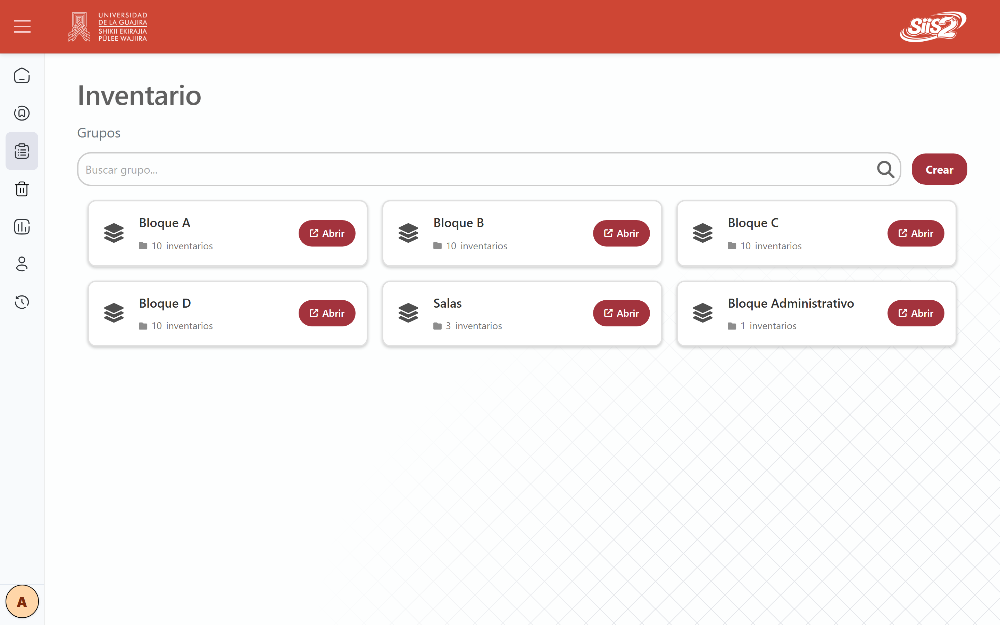
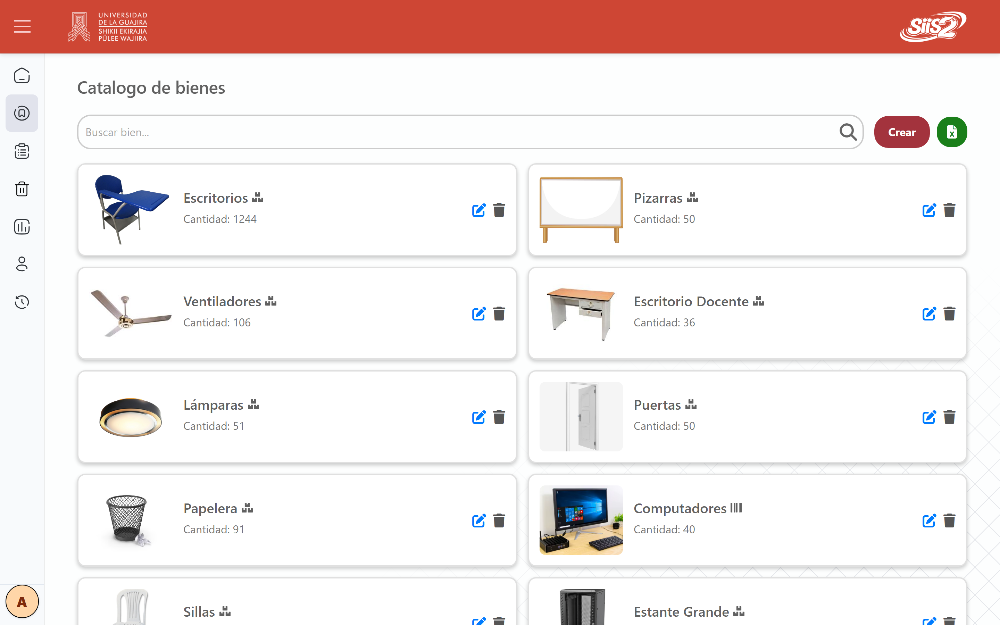
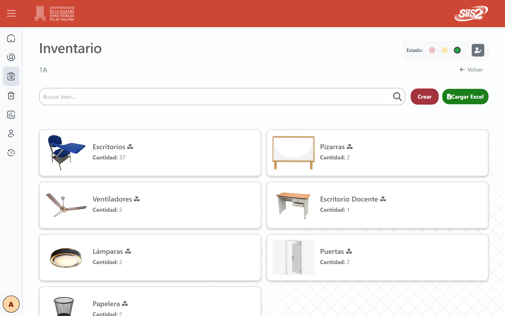
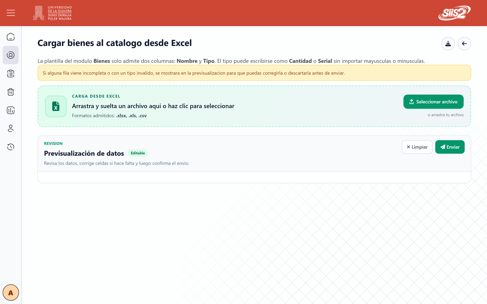
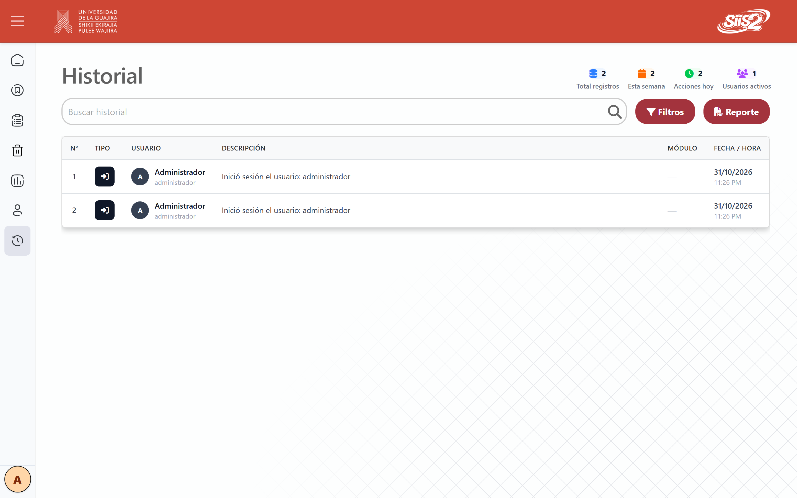

# 📦 Inventario Uniguajira v2 — Control de inventario de bienes

> Migración de la aplicación de inventario de bienes de la **Universidad de La Guajira** a **Laravel 12**,
> para tener una base más robusta y fácil de mantener. Proyecto en equipo, noviembre de 2025 a abril de 2026.

`Laravel 12` · `PHP 8.3` · `Livewire 3` · `Flux UI` · `Tailwind CSS 4` · `MySQL` · `Pest` · `Docker`

> **Problem:** University assets live in spreadsheets: hard to know what is where, what was written off and who changed what.  
> **Solution:** A web app that organizes inventory as group, inventory and asset, with Excel bulk upload and an activity log.  
> **Stack:** Laravel 12, Livewire 3, Flux UI, Tailwind CSS 4, MySQL, Pest, Docker.  
> **Live demo:** None public (internal university system; the source repository is private).  
> **My role:** Member of a four-person team: data layer and SQL views, assets and inventory modules, Excel import, users, history and login UI, and tests.

*Capturas de la base de datos de ejemplo del repositorio: bienes genéricos, sin datos reales.*

---

## El problema
La universidad lleva el inventario de sus bienes (escritorios, pizarras, ventiladores, computadores)
repartido por bloques, salas y oficinas. Con la aplicación original y las hojas de Excel era difícil
saber cuántos bienes había en cada lugar, cuáles se habían dado de baja y quién había hecho un cambio.
Además, el código heredado costaba mantenerlo y ampliarlo.

## La solución
Una aplicación web que ordena el inventario en tres niveles (**grupo → inventario → bien**) y deja
rastro de cada acción:

- **📦 Catálogo de bienes** con foto y dos tipos de control: por **cantidad** o por **serial**.
- **🏢 Inventarios por bloque y salón,** con responsable y estado (semáforo de tres colores).
- **📥 Carga masiva desde Excel** con previsualización editable: las filas con error se corrigen o
  se descartan antes de enviar.
- **🗑️ Bajas** con filtros, estadísticas y exportación.
- **🧾 Historial de actividad** de usuarios y de modelos, con reporte en PDF.
- **👥 Roles** de administrador y consultor, con inicio de sesión mediante Fortify y 2FA.

## Capturas

| | |
|---|---|
|  |  |
| *Catálogo global de bienes.* | *Los bienes de un salón.* |
|  |  |
| *Carga masiva con previsualización.* | *Historial de actividad.* |

## Decisiones técnicas destacadas
- **Vistas SQL para los listados.** Tres vistas (`assets_summary_view`, `inventory_goods_view`,
  `serial_goods_view`) entregan los agregados ya calculados, en vez de cargar y sumar en PHP, para que
  los listados sigan siendo ligeros cuando crece el inventario.
- **Livewire y Blade en lugar de una SPA.** La app es sobre todo formularios y tablas; renderizar en
  el servidor redujo la cantidad de código del frontend. La navegación entre inventarios usa AJAX con
  manejo del historial del navegador, para no recargar toda la página.
- **Carga masiva pensada para escalar.** La vista de alta por Excel se separó de la de creación
  manual, la plantilla se descarga desde la app y los componentes de carga y previsualización se
  comparten entre módulos. Hay pruebas de rendimiento de la importación.
- **Trazabilidad en tres capas.** Un helper en los controladores, un *listener* de eventos de
  autenticación y un *observer* de modelos alimentan un único historial.
- **Pruebas por rol.** La suite Pest corre sobre SQLite en memoria, está organizada por módulo y por
  rol, e incluye un test transversal que recorre las rutas web. Hay una guía (`tests/TEST.md`) para
  que cualquiera del equipo agregue pruebas con el mismo formato.
- **Un solo método de estilos.** Tailwind es la única forma de escribir estilos; los CSS heredados
  están congelados y se reemplazan al tocar cada vista.
- **Despliegue con Docker** (imagen multietapa, Nginx y script de arranque) y HTTPS forzado en
  producción.

## Números del repositorio
13 modelos · 12 controladores · 19 migraciones · 23 archivos de pruebas. Desarrollado entre el
8 de noviembre de 2025 y el 21 de abril de 2026.

## Resultado
Migración funcional y desplegada: gestión de bienes, grupos, inventarios, bajas, reportes, usuarios e
historial. El último cambio fue una corrección del inicio de sesión en producción.

## Mi rol
Proyecto en equipo de **cuatro personas**. Me encargué de:

- las migraciones, modelos y seeders de la capa de datos y las **vistas SQL**,
- el módulo de **bienes** (CRUD completo, serial y cantidad, alta por Excel con plantilla),
- los **inventarios** y su navegación con AJAX,
- el módulo de **inicio** con tareas,
- la mejora de la interfaz de **usuarios**, **historial** y **login**,
- los **tests** de inicio y tareas por rol, y el Dockerfile para desplegar.

---

> 🔒 **Código fuente privado.** Este repositorio es solo el *case study*. Puedo mostrar el código y la
> aplicación funcionando en una entrevista técnica.

**Contacto:** [GitHub](https://github.com/KevinHGitCode) · kevinhafiddiazgarcia@gmail.com
